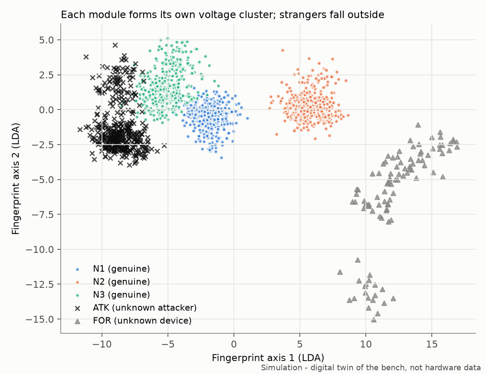

# Open-Set ECU Voltage Fingerprinting for CAN-Bus Intrusion Detection

An embedded intrusion-detection "guardian" for automotive CAN. It identifies **which physical ECU sent each frame** from the analog CAN_H/CAN_L waveform rather than from the frame contents. Spoofed frames are flagged even when the attacker uses a legitimate ID and valid data. The project includes a 3-node CAN bench (Arduino + MCP2515/TJA1050), an STM32 guardian node, a bit-level digital twin of the bench, and an IEEE-format paper.



## Problem statement
CAN has no sender authentication. Any node can transmit any ID, so a compromised or foreign ECU can masquerade as a legitimate one. Cryptographic MACs need bandwidth and key management that legacy ECUs cannot provide. Every transceiver, however, has small analog differences: dominant levels, edge ringing and noise. These form a **physical-layer fingerprint** that can be learned and checked by a low-cost monitor.

## Objectives
1. Build a multi-node CAN bench and a guardian node that receives every frame.
2. Model the bench bit by bit, including transceiver variation, ADC sampling and attacks.
3. Extract lightweight statistical features and classify the sender with a model small enough for a microcontroller.
4. Reject **never-seen devices** (open-set) and detect interleaved spoofing quickly (CUSUM).
5. Estimate the memory and CPU budget on the guardian MCU.

## System architecture
```
 Node TX (0x100)  Node TX (0x200)  Node TX (0x300)   Attacker / foreign device
      │                │                │                    │
 ═════╪════════════════╪════════════════╪════════════════════╪═══════ CAN bus 125 kbit/s
      │                                                      │
 GUARDIAN: CAN_H/CAN_L ─► 100k/100k divider ─► CA3130 buffer ─► 12-bit dual ADC (1 MS/s, STM32F103)
   1 frame sync + bit decode → 2 ID read from waveform → 3 15 moment features
   → 4 linear SVM (sender) → 5 Mahalanobis open-set check → 6 ID-owner check
   → 7 per-ID CUSUM → 8 alarm log
```

## Hardware
| Part | Role |
|---|---|
| Arduino Nano ×3 + MCP2515 (8 MHz) + TJA1050 | Transmitting ECUs (IDs 0x100 / 0x200 / 0x300) and receiver |
| STM32F103 ("Blue Pill") + MCP2515 | Guardian node (SPI2: PB13/14/15, CS PB12, UART1 PA9/PA10, LED PC13) |
| 120 Ω terminations, twisted pair | CAN bus |

## Firmware (`firmware/`)
| Sketch | Board | Function |
|---|---|---|
| `node_tx` | Arduino Nano | Sends an 8-byte frame every 100 ms with a rolling counter. `NODE_ID` sets 0x100 / 0x200 / 0x300 / attacker. |
| `node_rx` | Arduino Nano | Interrupt-driven receiver that prints ID, DLC and payload |
| `guardian_stm32` | STM32F103 (STM32duino) | Receives all frames, bounds-checks the DLC, and logs a timestamp, ID and counter over UART |

All sketches use the `mcp_can` library (coryjfowler) at 125 kbit/s with an 8 MHz crystal.

## Simulation (`simulation/`)
- **`sim1_virtual_ecus.py`:** 8 synthetic ECUs and 15 features (mean, variance, skewness, kurtosis, 5th moment on CAN_H, CAN_L, CAN_diff). It compares 7 classifiers on accuracy, size and speed, tests 0–60 mV drift, rejects 3 unseen ECUs, and compares a 10-of-10 batch alarm against CUSUM.
- **`sim2_digital_twin_testbed.py`:** bit-accurate digital twin of the bench above. 125 kbit/s; N1/N2/N3 at 20/40/100 ms; device parameters drawn from TJA1050 datasheet ranges; ADC at 8 samples/bit. It runs a 65 s scenario: enrolment, then **(A)** masquerade, **(B)** interleaved spoofing at 30 %, **(C)** a foreign device.

## Results (digital-twin simulation, `results/results.json`)
> These are **simulation results**, not hardware measurements.

| Metric | Value |
|---|---|
| Frames processed | 5,734 |
| Sender ID decoded from waveform | 100 % |
| Closed-set sender accuracy (linear SVM) | **97.73 %** |
| Open-set (unknown device) detection | **99.5 %** |
| Genuine-frame false rejects | 0.77 % |
| False alarms during normal traffic | **0** |
| Detection latency: A masquerade / B 30 % spoof / C foreign device | **0.12 s** / 7.27 s / 0.70 s (CUSUM) |
| Model size | **1,396 bytes** |
| Estimated guardian CPU load | ≈ 6.3 % (13.4 k ops/frame at 85 frames/s) |

The figures `fig1_waveforms`, `fig2_fingerprints`, `fig3_attack_timeline` and `fig4_confusion` and the full `guardian_log.txt` are in `results/`. The CUSUM detector catches interleaved spoofing (attack B) that a 10-of-10 batch alarm never flags.

## Setup and usage
```bash
pip install numpy scipy scikit-learn matplotlib
cd simulation
python sim1_virtual_ecus.py
python sim2_digital_twin_testbed.py      # writes ./out_testbed/
```
For hardware, install the `mcp_can` library in the Arduino IDE and flash `node_tx` (set `NODE_ID` per node) and `node_rx`. Flash `guardian_stm32` with the STM32duino core. Wire every MCP2515 over SPI and connect CAN_H/CAN_L on a terminated bus.

## Status and limitations
- **Done:** 3-node CAN bench with frame exchange; guardian receives and logs all traffic; full detection pipeline in simulation; IEEE-format paper (`paper/`).
- **Not done yet:** the analog front end (divider, CA3130 buffer and dual-ADC capture on the STM32), so the fingerprinting runs only on simulated waveforms so far.
- Device variation is modelled from datasheet ranges. Real transceivers, cable length and temperature may behave differently.

## Future improvements
- Build the analog front end and collect a real per-ECU waveform dataset.
- Port the SVM, Mahalanobis and CUSUM pipeline to C on the STM32 and measure the real CPU load.
- Test temperature and supply drift with periodic re-enrolment, and extend to CAN-FD.

## Paper
`paper/project1.tex` is the IEEEtran source, with TikZ figures in `paper/tikz/` and plots in `paper/fig/`. Cited papers are referenced by DOI and are not redistributed here.

## Technologies
`CAN bus` `MCP2515` `TJA1050` `STM32F103` `Arduino` `SPI` `Embedded ML` `Linear SVM` `Open-set recognition` `CUSUM` `Python` `scikit-learn` `Automotive cybersecurity` `LaTeX`
